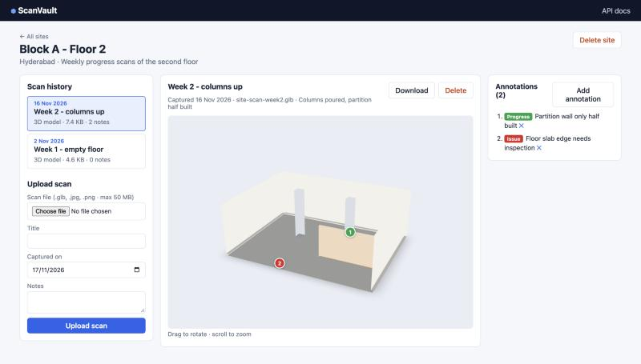

# ScanVault – Site-Scan Management Platform

ScanVault is a small cloud platform for **reality-capture data**: teams create *sites* (a building floor, a construction site), upload *scans* of them over time (3D models or photos), view them in the browser, and pin *annotations* at exact 3D positions ("crack near this window", "partition half built").

Built with **C# / ASP.NET Core Web API**, **Entity Framework Core + SQL**, **React**, and **Azure** (App Service, Azure SQL, Blob Storage), with **xUnit** tests and a **GitHub Actions** CI/CD pipeline.



## Features

- **REST API** for sites, scans and annotations, with Swagger / OpenAPI docs at `/swagger`
- **Scan uploads** (`.glb` 3D models, `.jpg`/`.png` photos, up to 50 MB) stored in **Azure Blob Storage**; SQL keeps only the metadata
- **Scan history** per site, newest first, so progress can be compared over time
- **3D viewer** in React (rotate, zoom) with **location-pinned annotations**: click the model to drop a pin at that X/Y/Z point
- Input validation, consistent JSON errors (ProblemDetails), and a `/health` endpoint
- **24 automated tests**: service-layer unit tests and full HTTP API tests

## Architecture

```
React (Vite)  ──HTTP/JSON──►  Controllers  ──►  Services  ──►  Repositories  ──►  EF Core  ──►  Azure SQL
                                                    │
                                                    └──►  IFileStorage  ──►  Azure Blob Storage
```

| Layer | Folder | Job |
|---|---|---|
| Controllers | `src/ScanVault.Api/Controllers` | HTTP routes, status codes, request/response shapes |
| Services | `src/ScanVault.Api/Services` | Business rules (file validation, history order, cleanup) |
| Repositories | `src/ScanVault.Api/Repositories` | Database queries through EF Core |
| Storage | `src/ScanVault.Api/Storage` | Where files live: local disk (dev) or Azure Blob Storage |
| Models / DTOs | `Models`, `Dtos` | Database entities vs. the JSON the API exposes |

The same code runs locally and on Azure. Configuration picks the database and file storage:

| Setting | Local default | Azure |
|---|---|---|
| `Database:Provider` | `Sqlite` | `SqlServer` (Azure SQL, schema via EF Core migrations) |
| `Storage:Provider` | `Local` (`App_Data/scans`) | `AzureBlob` (container `scans`) |

## API

| Method | Route | Description |
|---|---|---|
| GET | `/api/sites` | All sites with scan count and last capture date |
| POST | `/api/sites` | Create a site |
| GET | `/api/sites/{id}` | One site with its scan history |
| PUT | `/api/sites/{id}` | Update a site |
| DELETE | `/api/sites/{id}` | Delete a site, its scans, annotations and files |
| GET | `/api/sites/{id}/scans` | Scan history, newest first |
| POST | `/api/sites/{id}/scans` | Upload a scan (multipart/form-data) |
| GET | `/api/scans/{id}` | Scan metadata |
| GET | `/api/scans/{id}/file` | Download / stream the scan file |
| DELETE | `/api/scans/{id}` | Delete a scan and its file |
| GET | `/api/scans/{id}/annotations` | Annotations on a scan |
| POST | `/api/scans/{id}/annotations` | Pin an annotation at X/Y/Z |
| DELETE | `/api/annotations/{id}` | Delete an annotation |
| GET | `/health` | Health check (includes database connectivity) |

## Run locally

Needs the [.NET 10 SDK](https://dotnet.microsoft.com/download) and Node.js 20+. No cloud account required.

```bash
# 1. Build the React app into the API's wwwroot
cd frontend && npm install && npm run build && cd ..

# 2. Run the API (serves the app too)
dotnet run --project src/ScanVault.Api --launch-profile http
```

Open http://localhost:5297 (app) and http://localhost:5297/swagger (API docs).
Sample scans to upload are in `samples/` (regenerate with `python3 tools/make_sample_scans.py`).

For front-end development with hot reload, run the API as above and `npm run dev` in `frontend/` (http://localhost:5173, API calls are proxied).

## Tests

```bash
dotnet test
```

- `tests/ScanVault.Tests/Services` – unit tests for each service against an in-memory SQLite database and a fake file store
- `tests/ScanVault.Tests/Api` – starts the whole API in memory and tests real HTTP calls (create → upload → annotate → download, validation errors, 404s, health)

## Deploy to Azure

1. Log in: `az login` and `gh auth login`
2. Create the Azure resources and connect GitHub Actions:
   ```bash
   bash infra/azure-setup.sh
   ```
   This creates a resource group, an Azure SQL database (free offer), a Storage account with a `scans` container, and a Linux App Service (F1), configures the app, and stores the deploy credentials as a GitHub secret.
3. Push to `main`. The [CI/CD workflow](.github/workflows/ci-cd.yml) builds the React app, runs the tests, publishes the API and deploys it to App Service. On first start the app applies the EF Core migrations to Azure SQL.

## Tech stack

C# 14 · .NET 10 · ASP.NET Core Web API · Entity Framework Core 10 · Azure SQL / SQL Server · SQLite (dev) · Azure Blob Storage · Azure App Service · React 18 · Vite · `<model-viewer>` (three.js) · xUnit · Swagger / OpenAPI · GitHub Actions
